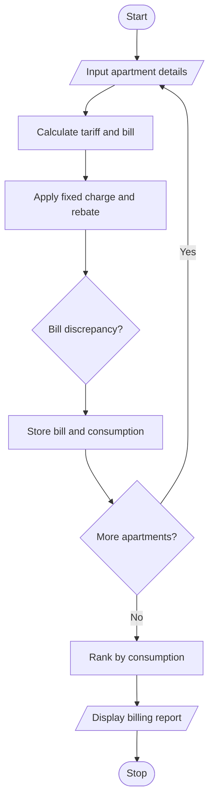

# Smart Electricity Billing for Multiple Apartments Using Python

## 1. Problem Statement

To develop a Python program that calculates electricity bills for multiple apartments using progressive tariffs, fixed charges, and rebates. The program checks for billing discrepancies by comparing calculated bills with reported bills and ranks apartments according to electricity consumption.

## 2. Algorithm

1. Start.
2. Input the number of apartments.
3. For each apartment, enter its ID, electricity consumption, and reported bill.
4. Calculate the energy charge using progressive tariff slabs.
5. Add the fixed charge and apply any eligible rebate.
6. Compare the calculated bill with the reported bill to identify discrepancies.
7. Rank apartments by consumption in descending order.
8. Display apartment-wise bills, discrepancies, and rankings.
9. Stop.

## 3. Flowchart

## 5. Sample Input

Number of apartments: 3
Apartment ID: A101
Units consumed: 80
Reported bill: 247
Apartment ID: A102
Units consumed: 150
Reported bill: 460
Apartment ID: A103
Units consumed: 250
Reported bill: 850

## 6. Sample Output

--- ELECTRICITY BILLING REPORT ---

Rank: 1 | Apartment: A103
Units: 250
Calculated bill: Rs. 850.00
Reported bill: Rs. 850.00
Discrepancy: No

Rank: 2 | Apartment: A102
Units: 150
Calculated bill: Rs. 450.00
Reported bill: Rs. 460.00
Discrepancy: Yes

Rank: 3 | Apartment: A101
Units: 80
Calculated bill: Rs. 247.00
Reported bill: Rs. 247.00
Discrepancy: No

Tariff assumptions: First 100 units cost ₹2/unit, the next 100 cost ₹3/unit, and additional units cost ₹5/unit. The fixed charge is ₹100, with a 5% rebate for consumption of 100 units or less.
