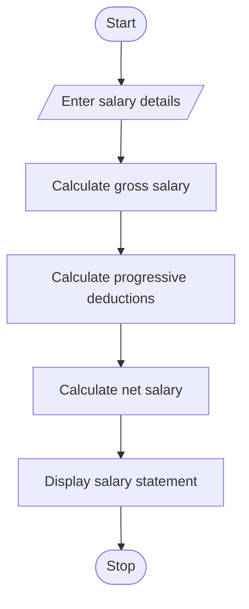

#  Employee Payroll and Deduction Analysis Using Python

## 1. Problem Statement

The Employee Payroll and Deduction Analysis system calculates an employee's gross salary using basic pay, allowances, overtime, and incentives. It applies progressive deductions based on salary and generates a formatted salary statement showing gross salary, total deductions, and net salary.

## 2. Algorithm

1. Start the program.
2. Enter employee name, basic salary, allowances, overtime pay, and incentives.
3. Calculate gross salary by adding all earnings.
4. Calculate progressive deductions based on gross salary.
5. Calculate net salary by subtracting total deductions from gross salary.
6. Display the formatted salary statement.
7. Stop the program.

Assumed deduction rules for this example:

- First ₹20,000: 5% deduction.
- Next ₹20,000: 10% deduction.
- Amount above ₹40,000: 15% deduction.

These are example rates for the project, not official payroll or tax rules.

## 3. Flowchart using Mermaid

## 5. Sample Input

Enter employee name: Ravi
Enter basic salary: Rs. 35000
Enter allowances: Rs. 5000
Enter overtime pay: Rs. 2000
Enter incentives: Rs. 3000

## 6. Sample Output

------ SALARY STATEMENT ------
Employee Name : Ravi
Basic Salary  : Rs. 35000.0
Allowances    : Rs. 5000.0
Overtime Pay  : Rs. 2000.0
Incentives    : Rs. 3000.0
Gross Salary  : Rs. 45000.0
Deductions    : Rs. 3750.0
Net Salary    : Rs. 41250.0

