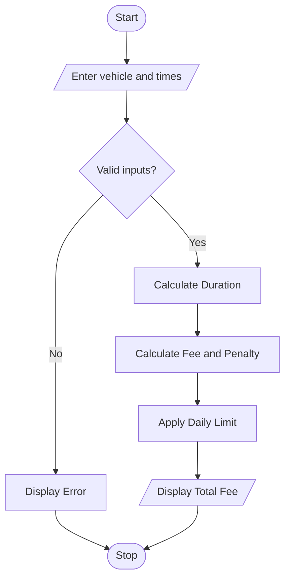

# Smart Parking Fee Management System

## 1. Problem Statement

To develop a Python program that calculates parking fees based on vehicle category, entry and exit times, overnight parking, daily fee limits, and penalty conditions. The program validates the input times and displays the final parking charge.

## 2. Algorithm

1. Start.
2. Define parking rates for bikes, cars, and trucks.
3. Input vehicle category, entry time, and exit time.
4. Validate the inputs.
5. Calculate parking duration, including overnight parking.
6. Calculate the fee based on hourly rates and the daily limit.
7. Add applicable penalties.
8. Display the total parking fee.
9. Stop.

## 3. Flowchart 

## 5. Sample Input

`
Vehicle (bike/car/truck): car
Entry time (HH:MM): 21:00
Exit time (HH:MM): 02:30

## 6. Sample Output

Parking duration: 6 hours
Base fee: Rs. 300
Penalty: Rs. 50
Total fee: Rs. 350

ed to calculate longer stays accurately.
