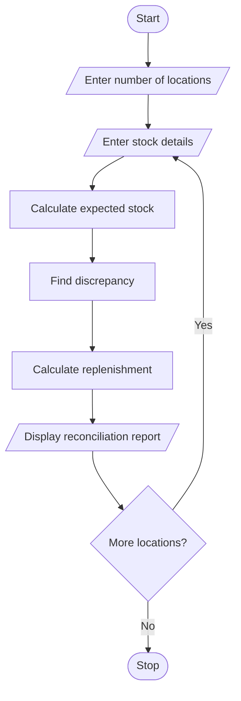

#  Food Supply Chain Stock Reconciliation Using Python

## 1. Problem Statement

Develop a Python program to manage and reconcile food stock across several locations. The program should accept quantities received, distributed, damaged, and remaining at each location. It should calculate the expected remaining stock, identify discrepancies between expected and actual stock, and determine the replenishment quantity required to meet the minimum stock level.

## 2. Algorithm

1. Start the program.
2. Enter the number of locations.
3. For each location, enter:
   - Location name
   - Quantity received
   - Quantity distributed
   - Quantity damaged
   - Actual remaining stock
   - Minimum required stock
4. Calculate expected remaining stock:

&#x20;  Expected Stock = Received − Distributed − Damaged

5. Compare expected stock with actual remaining stock.
6. Calculate discrepancy:

&#x20;  Discrepancy = Expected Stock − Actual Stock

7\. Calculate replenishment required:

Replenishment = Minimum Stock − Actual Stock (if positive, otherwise 0).\
8\. Display the stock reconciliation report.\
9\. Stop.

## 3. Flowchart

## 5. Sample Input

Enter number of locations: 2

Location 1
Enter location name: Central Store
Quantity received: 1000
Quantity distributed: 600
Quantity damaged: 50
Actual remaining stock: 340
Minimum required stock: 400

Location 2
Enter location name: North Store
Quantity received: 800
Quantity distributed: 500
Quantity damaged: 20
Actual remaining stock: 280
Minimum required stock: 350

## 6. Sample Output

--- Stock Report ---
Location: Central Store
Expected Stock: 350
Actual Stock: 340
Discrepancy: 10
Status: Stock Shortage
Replenishment Required: 60

--- Stock Report ---
Location: North Store
Expected Stock: 280
Actual Stock: 280
Discrepancy: 0
Status: Stock Matched
Replenishment Required: 70

