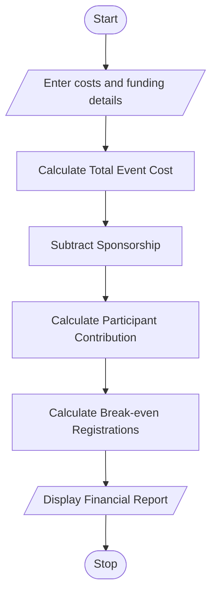

# Campus Event Financial Planning Using Python

## 1. Problem Statement

To develop a Python program to calculate the total expenses of a campus event, including venue, equipment, catering, transport, and certificates. The program calculates the participant contribution, sponsorship shortfall, and minimum number of registrations required to break even.

## 2. Algorithm

1. Start.
2. Input venue, equipment, catering, transport, certificate costs, sponsorship amount, participant contribution, and expected participants.
3. Calculate the total event cost.
4. Calculate the amount remaining after sponsorship.
5. Calculate the required contribution per participant.
6. Calculate the minimum registrations needed to break even.
7. Display all costs and financial details.
8. Stop.

## 3. Flowchart

## 5. Sample Input

Enter venue cost: 10000
Enter equipment cost: 5000
Enter catering cost per participant: 200
Enter transport cost: 3000
Enter certificate cost per participant: 50
Enter sponsorship amount: 8000
Enter contribution per participant: 400
Enter expected participants: 100

## 6. Sample Output

--- CAMPUS EVENT FINANCIAL REPORT ---
Total event cost: Rs. 48000.0
Sponsorship: Rs. 8000.0
Sponsorship shortfall: Rs. 40000.0
Required contribution per participant: Rs. 400.0
Break-even registrations: 34

