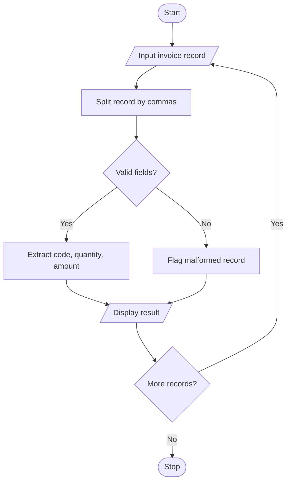

# Text-Based Invoice Data Extraction Using Python

## 1. Problem Statement

To develop a Python program that processes formatted invoice strings using basic string operations. The program extracts the product code, quantity, and amount from each invoice record and flags malformed records that do not follow the required format.

## 2. Algorithm

1. Start.
2. Input invoice records.
3. Split each record using commas.
4. Check whether the record contains exactly three fields.
5. Extract product code, quantity, and amount.
6. Validate the fields.
7. If valid, display the extracted data; otherwise, flag the record as malformed.
8. Repeat for all records.
9. Stop.

## 3. Flowchart

## 5. Sample Input

P101,2,500.00
P102,5,1250.50
P103,abc,300
P104,3
P105,2,-100

## 6. Sample Output

INVOICE DATA EXTRACTION
Code: P101, Quantity: 2, Amount: Rs. 500.00
Code: P102, Quantity: 5, Amount: Rs. 1250.50
Malformed record: P103,abc,300
Malformed record: P104,3
Malformed record: P105,2,-100

