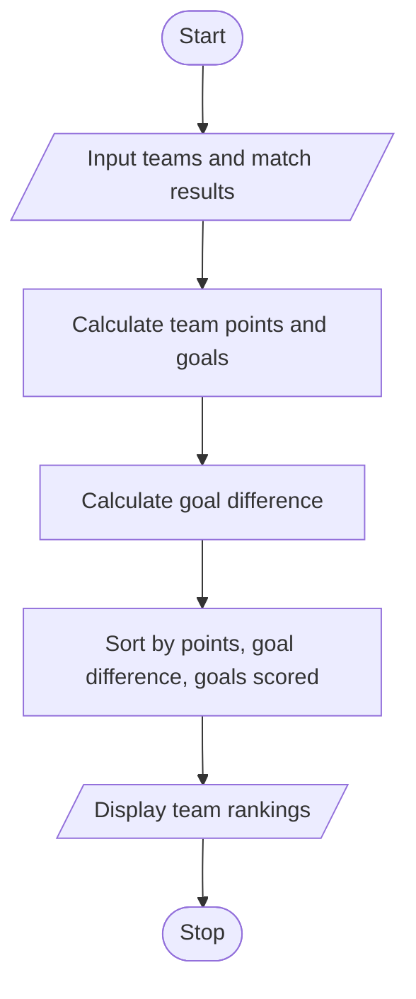

# Sports Tournament Ranking System Using Python

## 1. Problem Statement

To develop a Python program that stores sports tournament match results, calculates team points and tie-break values, and ranks teams according to a specified competition policy.

The program awards 3 points for a win, 1 point for a draw, and 0 points for a loss. Teams are ranked by total points first, then goal difference, and finally goals scored.

## 2. Algorithm

1. Start.
2. Input the number of teams and match results.
3. Initialize each team's points, goals scored, and goals conceded to zero.
4. Process each match and update team statistics.
5. Award 3 points for a win and 1 point to each team for a draw.
6. Calculate goal difference for each team.
7. Sort teams by points, goal difference, and goals scored in descending order.
8. Display the final tournament rankings.
9. Stop.

## 3. Flowchart 

## 5. Sample Input

For this program, enter each match as two team names followed by their goals.

Enter number of teams: 3
Enter team name: A
Enter team name: B
Enter team name: C
Enter number of matches: 3
Enter teams and goals (A B GA GB): A B
Enter goals for A: 2
Enter goals for B: 1
Enter teams and goals (A B GA GB): B C
Enter goals for B: 1
Enter goals for C: 1
Enter teams and goals (A B GA GB): C A
Enter goals for C: 0
Enter goals for A: 2

## 6. Sample Output

--- TOURNAMENT RANKINGS ---
Rank Team Points GF GA GD
1 A 6 4 1 3
2 B 1 2 3 -1
3 C 1 1 3 -2

