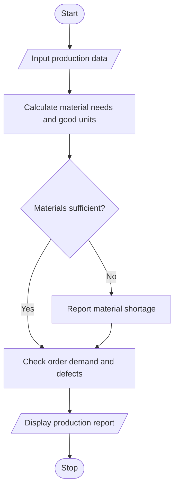

# Integrated Manufacturing Production Planner Using Python

## 1. Problem Statement

To develop a Python program that analyses available raw materials, production quantities, defect counts, and customer order demand. The program determines whether production is feasible, identifies material shortages, checks whether production can meet demand, and flags quality violations when defects exceed the permitted limit.

## 2. Algorithm

1. Start.
2. Input raw material available, material required per unit, production quantity, order demand, defect count, and maximum allowed defects.
3. Calculate the total material required.
4. Check whether available materials are sufficient.
5. Calculate good units by subtracting defective units from production quantity.
6. Compare good units with order demand.
7. Identify material shortages and quality violations.
8. Display the production feasibility report.
9. Stop.

## 3. Flowchart 

## 5. Sample Input

Available raw material: 350
Material required per unit: 2
Planned production quantity: 200
Order demand: 195
Number of defective units: 8
Maximum defect rate (%): 3

## 6. Sample Output

--- PRODUCTION REPORT ---
Material required: 400
Material shortage: 50
Good units: 192
Order shortage: 3
Defect rate: 4.00%
Production feasible: No
Quality status: Violation

 
