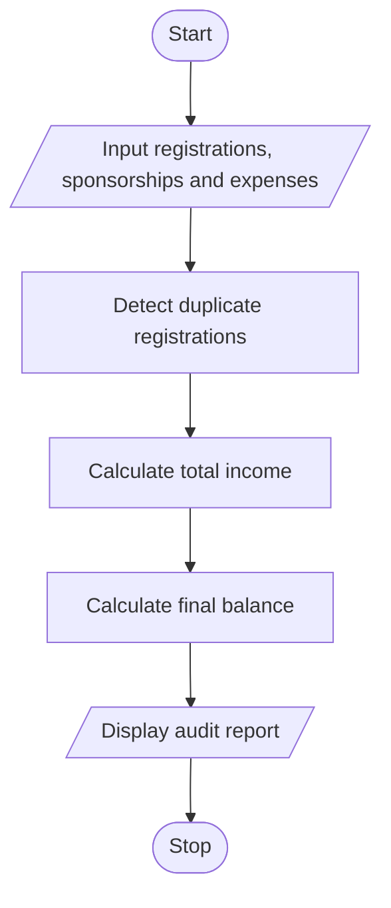

#  Campus Festival Registration and Financial Audit Using Python

## 1. Problem Statement

To develop a Python program that manages campus festival registrations and performs a financial audit. The program checks participant lists for duplicate registrations, calculates total registration fees and sponsorship contributions, records festival expenses, and determines the final financial balance.

## 2. Algorithm

1. Start.
2. Input participant registration IDs and fees.
3. Identify and flag duplicate registration IDs.
4. Calculate total fees from valid registrations.
5. Input sponsorship contributions and festival expenses.
6. Calculate total income and total expenses.
7. Determine the final balance.
8. Display duplicate registrations and the financial audit report.
9. Stop.

## 3. Flowchart

## 5. Sample Input

Enter number of registrations: 4
Enter participant ID: P101
Enter registration fee: 500
Enter participant ID: P102
Enter registration fee: 500
Enter participant ID: P101
Enter registration fee: 500
Enter participant ID: P103
Enter registration fee: 500
Enter total sponsorship: 2000
Enter total expenses: 2500

## 6. Sample Output

--- FESTIVAL FINANCIAL AUDIT ---
Valid registrations: 3
Duplicate IDs: ['P101']
Registration fees: Rs. 1500.0
Sponsorship: Rs. 2000.0
Total income: Rs. 3500.0
Total expenses: Rs. 2500.0
Final balance: Rs. 1000.0
Status: Surplus

